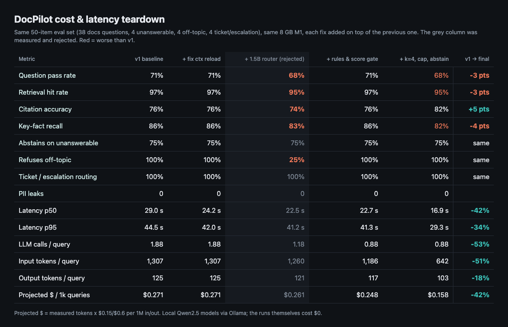

# Agent cost & latency teardown: DocPilot

**A RAG support agent went from 29.0 s to 16.9 s median latency (−42%), with 53% fewer LLM calls and 51% fewer input
tokens per query. A 50-item eval checked every change. It caught one regression, which was rejected, and the final
version scores within one question of v1.** Every number here is measured. The only projection is the dollar figure, marked as such.



The agent is [DocPilot](https://github.com/FardeenK29/docpilot), a LangGraph support bot over the FastAPI docs, with
citations, abstention, PII redaction and ticket/escalation tools. Measurement uses
[AgentLens](https://github.com/FardeenK29/agentlens), an OpenTelemetry callback handler.

## Setup

| | |
|---|---|
| Hardware | Apple M1, 8 GB RAM |
| Models | Qwen2.5 3B for answers (Ollama), nomic-embed-text for retrieval |
| Vector DB | Qdrant (local mode), 1,219 chunks from 114 docs pages |
| Eval set | 50 hand-written items: 38 docs questions, 4 unanswerable, 4 off-topic, 4 ticket/escalation (2 with PII) |
| Scoring | Deterministic, no LLM judge: cited the expected page, key-fact recall ≥ 50%, abstained/refused when it should, no PII leaked |
| Telemetry | AgentLens spans: LLM calls, input/output tokens and latency per query |

**Method.** One change per step, each on top of the last. Same eval set every time. The models are unloaded before each
run, two warm-up queries are discarded, and the Docker tracing stack is stopped so memory pressure doesn't skew the
latency (a first attempt with Docker running on the same 8 GB machine was thrown away for that reason).

Absolute latency reflects a small local model on a laptop. The relative changes, LLM calls and token counts are the
point; they carry over to hosted models.

## Findings

### 1. The model was being reloaded twice per request

The router and the answerer called the same 3B model with different context sizes (`num_ctx` 2048 and 8192). Ollama
treats those as two different runners, so it unloaded and reloaded the model on every switch. On an 8 GB machine, that
also evicted the embedding model.

The model server's log showed **131 model loads in one 50-item run**. After the fix (one shared context size), it
showed **2**. ([evidence](evidence/ollama-reloads.md), [script](scripts/count_reloads.py))

Nothing in the application logs showed this. From the app's side it just looked like slow LLM calls.

**Result:** median latency 29.0 s → 24.2 s, with identical answers (same pass rate, same tokens).

### 2. An LLM call on every message just to classify it

v1 sent every message to the LLM first to decide whether it was a docs question, a ticket request, an escalation or
off-topic. That's 1.88 LLM calls per query.

**First attempt, rejected:** obvious intents matched by rules, plus a 1.5B router model for the rest. It was faster
(1.18 calls per query), but the eval caught two regressions:

- Off-topic refusals fell from **100% to 25%**. The small model labelled "Who won the 2011 Cricket World Cup?" as a docs
  question, and a rule keyword (`file`) matched "help me file my income tax return".
- A docs question ("run a task after returning the response, like sending an email") went to the **ticket tool**.

Better prompts didn't fix it. The best version, a yes/no "is this about software?" prompt with examples, still
mislabelled 4 of 24 probe messages (eval items plus new ones).

**What shipped:** rules, then the retrieval score as the off-topic gate. The agent retrieves anyway, so the
similarity of a message to the nearest docs chunk is free. On the eval set it separates cleanly: every off-topic message
scored below 0.61, and every docs question 0.67 or higher. Messages no rule recognises are retrieved first, and refused
if the top score is below 0.62. There's no router LLM at all.

It isn't perfect. Of 10 new probe messages, one off-topic question ("How do I renew my passport?", 0.665) got past the
gate. The answerer then did what it's told to: it replied "I couldn't find that in the FastAPI docs." A gate is a cheap
first filter, not a guarantee.

**Result:** off-topic refusals back to 100%, and docs-question quality identical to v1 (same pass rate, citations
and key-fact recall). LLM calls per query fell from 1.88 to 0.88: the only call left is the answer itself (or the ticket
tool), and off-topic and escalation messages need no LLM at all. Median latency 24.2 s → 22.7 s, about the same as the
rejected router, with 0.3 fewer LLM calls per query and none of its mistakes.

### 3. Context bloat

v1 stuffed the top 8 chunks into every prompt, never capped answer length, and never abstained, even when nothing
relevant was retrieved.

The fix: top-4 chunks, a 350-token answer cap, and an abstain threshold (if the best match scores below 0.62, say "I
couldn't find that" and offer a ticket, without calling the LLM).

**Result:** input tokens per query 1,186 → 642 (−46%), median latency 22.7 s → 16.9 s, p95 41.3 s → 29.3 s.

Quality moved a little in both directions. The docs-question pass rate went from 71% to 68%: three questions newly
passed and four newly failed, a net change of one question out of 38. Citation accuracy went up (76% → 82%) and
key-fact recall went down (86% → 82%). With fewer chunks, the model cites more precisely but sometimes leaves out a
detail that a fifth or sixth chunk would have supplied. For a support bot, that trade is usually worth it. If it
weren't, k=5 would be the next thing to measure.

The abstain threshold never fired on this eval. All four unanswerable questions are phrased like real FastAPI
questions and scored ≥ 0.68, so abstention still came from the prompt. That worked for 3 of 4. On the fourth, the model
correctly said FastAPI has no built-in Redis caching decorator, but then suggested a third-party library instead of
using the exact "couldn't find that" reply, so the strict scorer counts it as a miss. The threshold is a cheap safety
net, not what earned these numbers.

## Results

| Metric | v1 baseline | + fix ctx reload | + 1.5B router (rejected) | + rules & score gate | + k=4, cap, abstain | v1 baseline → + k=4, cap, abstain |
|---|---:|---:|---:|---:|---:|---:|
| Question pass rate | 71% | 71% | 68% | 71% | 68% | -3 pts |
| Retrieval hit rate | 97% | 97% | 95% | 97% | 95% | -3 pts |
| Citation accuracy | 76% | 76% | 74% | 76% | 82% | +5 pts |
| Key-fact recall | 86% | 86% | 83% | 86% | 82% | -4 pts |
| Abstains on unanswerable | 75% | 75% | 75% | 75% | 75% | same |
| Refuses off-topic | 100% | 100% | 25% | 100% | 100% | same |
| Ticket / escalation routing | 100% | 100% | 100% | 100% | 100% | same |
| PII leaks | 0 | 0 | 0 | 0 | 0 |  |
| Latency p50 | 29.0 s | 24.2 s | 22.5 s | 22.7 s | 16.9 s | -42% |
| Latency p95 | 44.5 s | 42.0 s | 41.2 s | 41.3 s | 29.3 s | -34% |
| LLM calls / query | 1.88 | 1.88 | 1.18 | 0.88 | 0.88 | -53% |
| Input tokens / query | 1,307 | 1,307 | 1,260 | 1,186 | 642 | -51% |
| Output tokens / query | 125 | 125 | 121 | 117 | 103 | -18% |
| Projected $ / 1k queries | $0.271 | $0.271 | $0.261 | $0.248 | $0.158 | -42% |

*Projected $ = measured tokens x $0.15/$0.6 per 1M in/out. All runs use local Qwen2.5 models, which cost $0 to run.*

"1.5B router (rejected)" was measured and not carried forward; the next step builds on "+ fix ctx reload".

## What I'd tell a client from this

1. **Look below your code.** The biggest single latency win was a model-server setting, found in its log, not in a
   profiler.
2. **Measure quality alongside speed, every time.** The 1.5B router looked like a clear win on latency and cost. The eval
   was the only thing that showed it was refusing off-topic messages a quarter of the time.
3. **Use signals you already compute.** Retrieval similarity replaced a whole LLM call.
4. **Report the boring caveats.** With 38 docs questions, one question flipping moves the pass rate 2.6 points, so
   changes of a few points are within noise.

## Reproduce

```bash
git clone https://github.com/FardeenK29/docpilot && cd docpilot
# setup as in DocPilot's README (Ollama, ingest), then:
evals/run_all.sh                # all five presets, about 1h40m on an 8 GB M1
python ../agent-cost-teardown/scripts/count_reloads.py /opt/homebrew/var/log/ollama.log <start> <end>
```

`results/` holds the raw output of each run: per-item answers, routes, citations, tokens and latency, plus the summary.

## License

MIT
